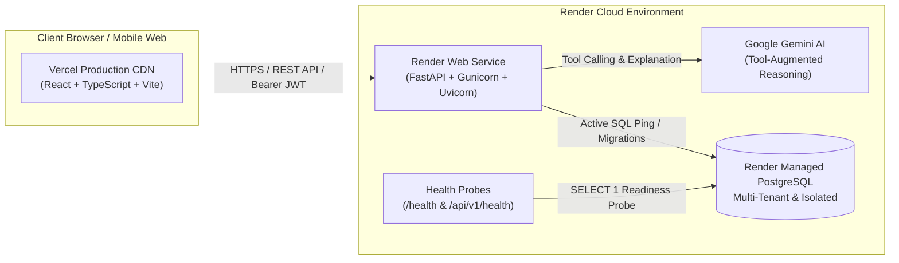

# ArthaFlow AI — Production Deployment Guide

> **Tagline:** *Understand money. Predict possibilities. Make smarter decisions.*  
> **Production Targets:** Frontend on **Vercel** | Backend & Database on **Render (PostgreSQL)**

---

## 1. Architecture & Deployment Overview



### Component Stack
| Component | Technology | Target Provider | Configuration / Build Artifacts |
|---|---|---|---|
| **Frontend** | React 18, TypeScript, Vite, Tailwind CSS, TanStack Query | **Vercel** | `frontend/dist/`, `frontend/vercel.json` |
| **Backend** | Python 3.12+, FastAPI, SQLAlchemy 2.x, Gunicorn, Uvicorn | **Render** | `backend/requirements.txt`, `backend/Procfile`, `render.yaml` |
| **Database** | PostgreSQL 16 (Render Managed) | **Render** | Alembic migrations in `backend/alembic/versions/` |
| **AI Layer** | Google Gemini API (gemini-2.5-flash / gemini-1.5-pro) | **Google AI Studio** | Server-side secure tool execution |

---

## 2. Prerequisites & Accounts

Before deploying, ensure you have:
1. A **GitHub** account containing the ArthaFlow repository.
2. A **Render** account ([render.com](https://render.com)).
3. A **Vercel** account ([vercel.com](https://vercel.com)).
4. A **Google Gemini API Key** from [Google AI Studio](https://aistudio.google.com/app/apikey).

---

## 3. Database Deployment (Render PostgreSQL)

### Step 3.1: Provision Managed PostgreSQL
1. Log in to your **Render Dashboard**.
2. Click **New +** > **PostgreSQL**.
3. Fill in the details:
   - **Name:** `arthaflow-db`
   - **Database Name:** `arthaflow`
   - **User:** `arthaflow_user`
   - **Region:** `Oregon (US West)` (or closest to your users)
   - **Plan:** Free or Starter
4. Click **Create Database**.
5. Once created, copy the **Internal Database URL** (for Render internal traffic) or **External Database URL**.
   *Note: Render URLs often start with `postgres://`. ArthaFlow's `config.py` automatically normalizes this to `postgresql://` for SQLAlchemy 2 compatibility.*

---

## 4. Backend Deployment (Render Web Service)

You can deploy the backend using either **Render Blueprints** (`render.yaml`) or **Manual Setup**.

### Option A: Automated via Render Blueprint (Recommended)
1. Push this repository to GitHub.
2. In Render, click **Blueprints** > **New Blueprint Instance**.
3. Connect your GitHub repository. Render will automatically read `render.yaml` and configure both the Web Service and PostgreSQL database.
4. Fill in the `GEMINI_API_KEY` when prompted in the environment variable prompt.
5. Click **Apply**.

### Option B: Manual Setup on Render
1. In Render Dashboard, click **New +** > **Web Service**.
2. Select your repository.
3. Configure the settings:
   - **Name:** `arthaflow-backend`
   - **Region:** `Oregon (US West)` (same region as your database)
   - **Branch:** `main`
   - **Root Directory:** *(leave blank or set to repository root)*
   - **Runtime:** `Python 3`
   - **Build Command:**
     ```bash
     cd backend && pip install -r requirements.txt && alembic upgrade head
     ```
   - **Start Command:**
     ```bash
     cd backend && gunicorn -k uvicorn.workers.UvicornWorker app.main:app -b 0.0.0.0:$PORT -w 2
     ```
   - **Health Check Path:** `/health`

4. Add the following **Environment Variables** in the Render settings:
   | Key | Value | Description |
   |---|---|---|
   | `PYTHON_VERSION` | `3.12.0` | Python runtime version |
   | `ENVIRONMENT` | `production` | Enables production security and CORS rules |
   | `DATABASE_URL` | *Your Render PostgreSQL connection string* | Internal DB URL from Step 3.1 |
   | `SECRET_KEY` | *(Click "Generate" or provide 32+ char hex)* | Used for cryptographic JWT signing |
   | `ACCESS_TOKEN_EXPIRE_MINUTES` | `1440` | JWT expiration (24 hours) |
   | `CORS_ORIGINS` | `https://<your-vercel-app>.vercel.app` | Comma-separated allowed frontend domains |
   | `GEMINI_API_KEY` | `AIzaSy...` | Server-side Gemini API key |

5. Click **Deploy Web Service**.
6. Wait for the build to finish. Once live, note your backend URL:  
   `https://arthaflow-backend.onrender.com`

---

## 5. Frontend Deployment (Vercel)

### Step 5.1: Import Project into Vercel
1. Log in to [vercel.com](https://vercel.com) and click **Add New...** > **Project**.
2. Select your GitHub repository.
3. In the project configuration screen:
   - **Framework Preset:** `Vite`
   - **Root Directory:** Click **Edit** and choose `frontend`.
   - **Build Command:** `npm run build` (or `tsc && vite build`)
   - **Output Directory:** `dist`
   - **Install Command:** `npm install`

### Step 5.2: Configure Environment Variables
Under the **Environment Variables** section, add:
| Key | Value | Description |
|---|---|---|
| `VITE_API_URL` | `https://arthaflow-backend.onrender.com/api/v1` | Your live Render backend API base |

*Note: The frontend code in `frontend/src/services/api.ts` automatically normalizes trailing slashes and handles both origin and `/api/v1` suffixes.*

### Step 5.3: Single Page Application (SPA) Routing & Security Headers
Vercel routing is already pre-configured in `frontend/vercel.json`:
```json
{
  "$schema": "https://openapi.vercel.sh/vercel.json",
  "rewrites": [
    {
      "source": "/(.*)",
      "destination": "/index.html"
    }
  ],
  "headers": [
    {
      "source": "/(.*)",
      "headers": [
        { "key": "X-Content-Type-Options", "value": "nosniff" },
        { "key": "X-Frame-Options", "value": "DENY" },
        { "key": "X-XSS-Protection", "value": "1; mode=block" }
      ]
    }
  ]
}
```
This guarantees that client-side routes (e.g. `/dashboard`, `/digital-twin`, `/lab`, `/decisions`) do not throw 404 errors on direct refresh.

### Step 5.4: Deploy & Verify Frontend
1. Click **Deploy**.
2. Once deployed, copy your assigned Vercel URL (e.g. `https://arthaflow.vercel.app`).
3. Return to your Render backend settings and update `CORS_ORIGINS` to include your exact Vercel URL:
   ```env
   CORS_ORIGINS=https://arthaflow.vercel.app
   ```

---

## 6. Database Migrations Runbook

### Automated Execution
Alembic migrations run automatically during each Render build via the build command:
```bash
alembic upgrade head
```

### Manual CLI Runbook
To verify or roll back migrations manually using the Alembic CLI:

```bash
# Navigate to backend directory
cd backend

# Inspect current revision
python -m alembic current

# Upgrade to latest migration
python -m alembic upgrade head

# Roll back by one revision (if needed)
python -m alembic downgrade -1

# View migration history
python -m alembic history --verbose
```

Initial revision ID: `f34762aed411_initial_schema.py` (includes all 14 entities: users, workspaces, accounts, transactions, categories, recurring items, snapshots, forecasts, risk alerts, simulations, decisions, outcomes, audit logs).

---

## 7. Demonstration Data Seeding

ArthaFlow AI includes a self-bootstrapping demonstration environment:

### Automatic Seeding on Startup
On the first server startup, the backend automatically seeds the demonstration tenant:
- **Demo User:** `aarav@aaravretail.in`
- **Demo Password:** `admin123`
- **Demo Workspace:** `Aarav Retail Enterprises` (Business mode, INR ₹ currency)
- **Preloaded Records:** Accounts, recurring leases/payroll, store transactions, and duplicate anomaly flags.

### Manual / Extended Seeding Script
To reload the full 60-transaction synthetic demonstration dataset:
```bash
cd backend
python scripts/seed_demo_environment.py
```
This generates:
- ₹1,20,000 opening cash across HDFC, ICICI, and Razorpay.
- 55+ realistic retail and wholesale transactions.
- ₹70,000 upcoming supplier invoices.
- Intentional duplicate transaction alert ready for evaluation.
- Pre-configured capex scenario for What-If testing.

---

## 8. Health-Check & Monitoring Endpoints

ArthaFlow exposes active health checks designed for cloud platform orchestrators (Render, Kubernetes, AWS ALB):

### Endpoints
- `GET /health` (Root probe)
- `GET /api/v1/health` (Versioned probe)

### Expected Response (HTTP 200 OK)
```json
{
  "status": "healthy",
  "platform": "ArthaFlow AI",
  "version": "1.0.0",
  "environment": "production",
  "database": "connected",
  "gemini_configured": true
}
```

### Database Failure Response (HTTP 503 Service Unavailable)
```json
{
  "status": "unhealthy",
  "platform": "ArthaFlow AI",
  "version": "1.0.0",
  "environment": "production",
  "database": "disconnected",
  "gemini_configured": true,
  "database_error": "could not connect to server: Connection refused"
}
```

---

## 9. Troubleshooting & Common Issues Runbook

### Issue 1: CORS Error in Browser Console (`Access-Control-Allow-Origin`)
- **Symptom:** Browser shows: `Cross-Origin Request Blocked: The Same Origin Policy disallows reading the remote resource at https://arthaflow-backend.onrender.com...`
- **Cause:** `CORS_ORIGINS` on Render does not match your exact Vercel domain (e.g. `https://arthaflow.vercel.app` vs `https://arthaflow-git-main.vercel.app`).
- **Fix:** In Render Dashboard > Web Service > Environment, update `CORS_ORIGINS`:
  ```env
  CORS_ORIGINS=https://arthaflow.vercel.app,https://arthaflow-*.vercel.app
  ```
  Render will immediately reload the worker processes.

### Issue 2: Render Free Tier Cold Starts
- **Symptom:** The first request after 15 minutes of inactivity takes 30-50 seconds to respond.
- **Cause:** Render free tier spins down idle web services.
- **Handling in Frontend:** The frontend includes built-in retry mechanisms and optimistic local caching (`demoData.ts` and `localStorage` fallback) so the UI remains responsive and functional even while the backend container wakes up.

### Issue 3: Render PostgreSQL Connection Error (`postgres://` Dialect)
- **Symptom:** `NoSuchModuleError: Can't load plugin: sqlalchemy.dialects:postgres`
- **Fix:** Render generates connection strings starting with `postgres://`, but SQLAlchemy 2 requires `postgresql://`. ArthaFlow's `backend/app/core/config.py` automatically rewrites `postgres://` to `postgresql://` on startup. Ensure `psycopg2-binary>=2.9.9` is present in `requirements.txt`.

### Issue 4: Gemini AI Rate Limits or Missing API Key
- **Symptom:** AI Agent responds with deterministic fallback message.
- **Cause:** `GEMINI_API_KEY` is not set or quota has been exhausted.
- **Fix:** Verify key at `https://aistudio.google.com/app/apikey`. Even without a valid key, the entire ArthaFlow AI platform functions deterministically via its rule-based financial engine and local scenario simulation algorithms.

### Issue 5: Vercel Page Refresh 404
- **Symptom:** Navigating to `/lab` works, but refreshing `https://your-domain.vercel.app/lab` shows `404 NOT_FOUND`.
- **Fix:** Ensure `frontend/vercel.json` is committed with the `"rewrites": [{"source": "/(.*)", "destination": "/index.html"}]` rule.

---

## 10. Pre-Flight Verification Checklist

Before final hackathon presentation, verify:
- [x] Backend passes all test suites (`python -m pytest backend/tests -v`).
- [x] Frontend compiles cleanly without TypeScript errors (`npm run build`).
- [x] Alembic migration table exists and is up to date (`alembic upgrade head`).
- [x] `/health` returns status `healthy` and database `connected`.
- [x] Demo credentials `aarav@aaravretail.in` / `admin123` log in successfully.
- [x] Dashboard metrics match the ₹1,20,000 cash balance.
- [x] What-If simulation engine executes deterministically.
- [x] No secrets or `.env` files are tracked in version control.
